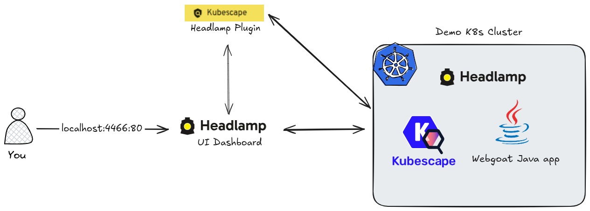
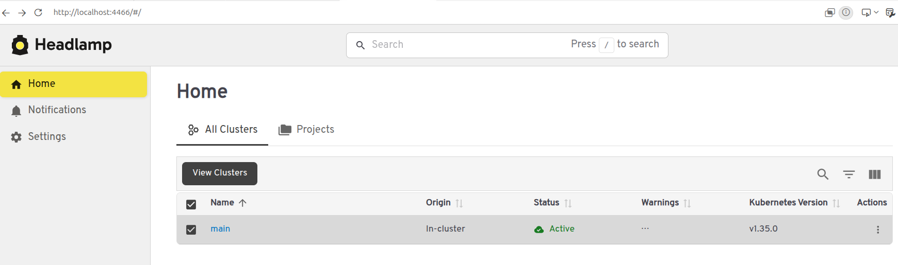
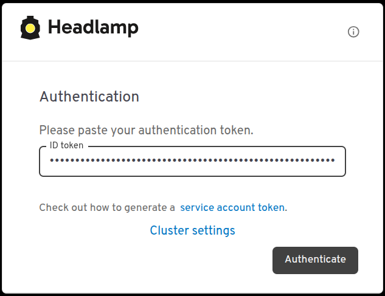
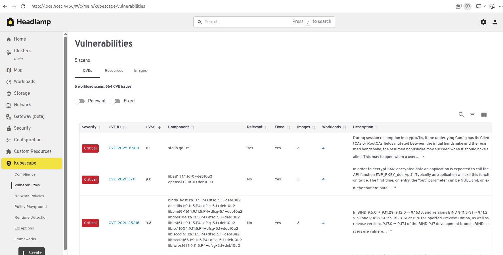

# Demo 3: Headlamp Dashboard for Kubescape

This demo shows how to install the Headlamp dashboard with the Kubescape plugin to visualize security scan results in a UI.



## Prerequisites

- [Docker](https://docs.docker.com/engine/install/)
- [kind](https://kind.sigs.k8s.io/docs/user/quick-start/#installation)
- [kubectl](https://kubernetes.io/docs/tasks/tools/)
- [Helm](https://helm.sh/docs/intro/install/)

## Create a Cluster

```bash
kind create cluster --config kind/config.yaml
```

Verify:

```bash
kubectl get nodes
```

## Install Kubescape Operator

Add the Kubescape Helm repository:

```bash
helm repo add kubescape https://kubescape.github.io/helm-charts/
helm repo update
```

> [!IMPORTANT] 
> When installing Kubescape make sure you enable **continuousScan** `--set capabilities.continuousScan=enable`  
> and **network observability** `--set capabilities.networkPolicyService=enable`.  
> This is requirement for Headlamp UI installation.    

Install the operator with `continuousScan` and `networkPolicyService` enabled:

```bash
helm install kubescape kubescape/kubescape-operator \
  --namespace kubescape \
  --create-namespace \
  -f kubescape/values.yaml
```

Wait for all pods to be ready:

```bash
kubectl get pods -n kubescape -w
```

## Install Headlamp

Add the Headlamp Helm repository:

```bash
helm repo add headlamp https://kubernetes-sigs.github.io/headlamp/
helm repo update
```

Install Headlamp with the **Kubescape plugin**:

```bash
helm install my-headlamp headlamp/headlamp \
  --namespace headlamp \
  --create-namespace \
  -f headlamp/values.yaml
```

**NOTE**  
Kubescape Headlamp plugin installed via this image: `quay.io/kubescape/headlamp-plugin:v0.11.2`

Wait for Headlamp to be ready:

```bash
kubectl get pods -n headlamp -l app.kubernetes.io/name=headlamp
```

## Access Headlamp UI

Port-forward the Headlamp service:

```bash
kubectl port-forward svc/my-headlamp -n headlamp 4466:80
```

Open http://localhost:4466 in your browser.



To log in, generate a service account token:

1. Create a Service Account:
```bash
kubectl -n headlamp create serviceaccount headlamp-admin
```
2. Give admin rights to the account:
```bash
kubectl create clusterrolebinding headlamp-admin --serviceaccount=headlamp:headlamp-admin --clusterrole=cluster-admin
```
3. Create the token for Kubernetes `v1.24+`:
```bash
kubectl create token headlamp-admin -n headlamp | tr -d '\n' | xclip -selection clipboard
```
4. Copy the token and log in:



For more information, see [Create a Service Account token](https://headlamp.dev/docs/latest/installation/#create-a-service-account-token).


## Deploy a Vulnerable Workload

To have real findings to show in the dashboard, deploy [OWASP WebGoat](https://owasp.org/www-project-webgoat/), a deliberately insecure Java (Spring Boot) application built for security training. An older tag (`v2023.4`) is pinned on purpose, so the image ships outdated dependencies with known CVEs.

> [!WARNING]
> WebGoat is intentionally vulnerable. Run it only in this local kind cluster. The manifest creates no Service or Ingress, so the app is not exposed. Do not expose it.

```bash
kubectl apply -f webgoat/deployment.yaml
```

Wait for the pod to be ready (the image is ~400 MB, first pull takes a while):

```bash
kubectl get pods -n webgoat -w
```

## Static Scan

To statically scan the cluster:
```bash
kubescape scan
```

## Trigger Scans

By default the operator scans on a daily schedule. To see results immediately, trigger both scan types manually:

```bash
# Configuration scan (compliance / security posture)
kubectl create job --from=cronjob/kubescape-scheduler manual-scan -n kubescape

# Vulnerability scan (image CVEs)
kubectl create job --from=cronjob/kubevuln-scheduler manual-vuln-scan -n kubescape
```

Watch the scan jobs complete:

```bash
kubectl get pods -n kubescape -w
```

Once the pods reach `Completed`, **refresh the browser** — the Kubescape plugin does not auto-update and requires a manual refresh to display new results.



In Headlamp, open **Kubescape --> Vulnerabilities** and filter by the `webgoat` namespace. The `webgoat` workload lists its CVEs with severity, affected package and fixed version. Since `continuousScan` is enabled, the plugin can also show which vulnerable components are actually loaded at runtime, not just present in the image.

To check the same image from the CLI:

```bash
kubescape scan image webgoat/webgoat:v2023.4
```

## Cleanup

```bash
kind delete cluster --name kubescape-headlamp-demo
```

## References
- [Introducing a Visual Way to Explore Kubernetes Security: the Kubescape Plugin for Headlamp
](https://kubescape.io/blog/2025/04/30/kubescape-headlamp/)
- [Headlamp In-cluster Installation](https://headlamp.dev/docs/latest/installation/in-cluster/)
- [Kubescape Headlamp Plugin: github.com/kubescape/headlamp-plugin/](https://github.com/kubescape/headlamp-plugin/)
- [OWASP WebGoat: github.com/WebGoat/WebGoat](https://github.com/WebGoat/WebGoat)
